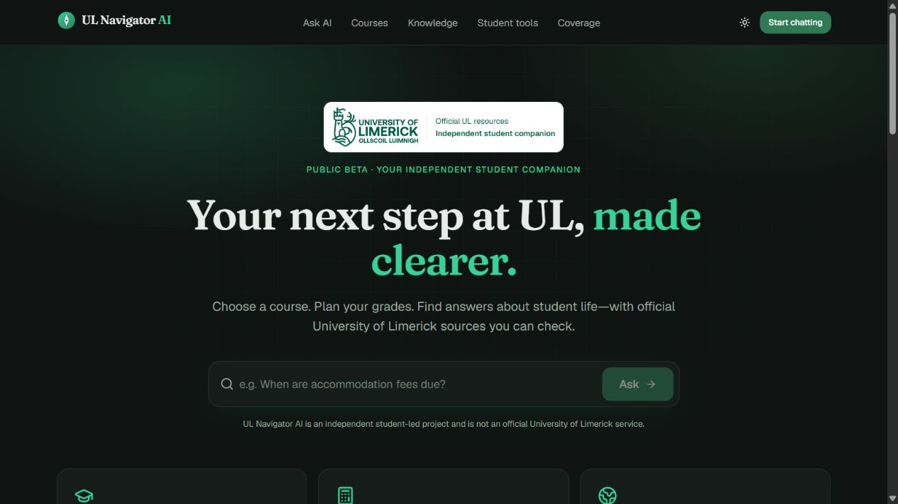
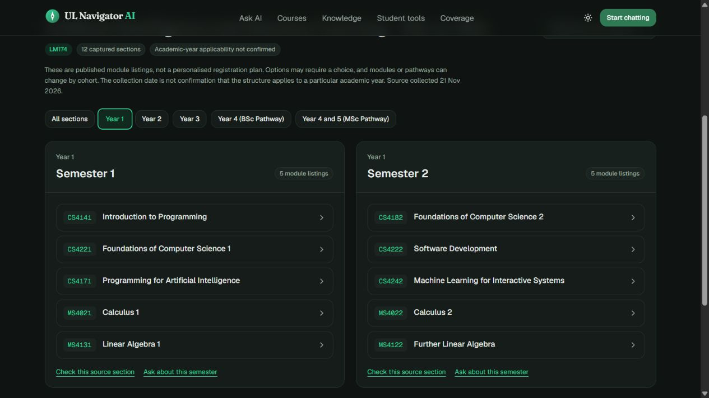
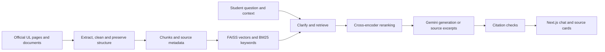

# UL Navigator AI

A source-grounded assistant that helps students explore University of Limerick programmes, modules and student services.

**[Try the live app](https://ul-navigator-ai.vercel.app/) · [Explore semester maps](https://ul-navigator-ai.vercel.app/curricula?course=LM174)**

Built by **John Elifuraha Mziray**, BSc Artificial Intelligence & Machine Learning, University of Limerick.

> Independent student-led project. This is not an official University of Limerick service and is not endorsed by UL. Important decisions should be confirmed with the relevant university office.



## What it does

- Answers student questions using retrieved official UL pages and documents, with source citations.
- Asks for the programme, year or pathway when a question needs clarification and supports contextual follow-ups.
- Provides progressive chat replies, conversation history, source previews and feedback controls.
- Browses programmes by study year and semester, keeping pathways, options and placements separate.
- Opens module content, including credits, syllabus, prerequisites and learning outcomes when indexed.
- Includes course search and comparison, a QCA calculator, grade planner, knowledge explorer and coverage dashboard.
- Falls back to cited source excerpts when generation is unavailable; missing evidence is shown explicitly.
- Gives maintainers a protected dashboard for source ingestion, indexing and feedback review.

The November 2026 curriculum snapshot contains **163 programme maps**, **1,085 sections** and **4,334 coded module listings**, drawn from 176 checked course records. It does not establish complete coverage of every UL course, elective or academic-year cohort. The live knowledge base can differ from the repository snapshot as collection continues.



## How it works



**Stack:** Next.js, React, TypeScript, Tailwind CSS, FastAPI, SQLAlchemy, SQLite, FAISS, BM25, Sentence Transformers and Gemini. The live frontend runs on Vercel; its backend runs on Google Cloud Run. Repository deployment examples are generic and contain no production state or credentials.

See [architecture](docs/architecture.md), [programme ingestion](docs/programme-modules.md) and [security](docs/security.md).

## Run locally

Use Python 3.12 and Node.js 22. Embedding and reranking model downloads require internet access; a GPU is optional.

```powershell
git clone https://github.com/jemmziray-tech/ul-navigator-ai.git
cd ul-navigator-ai
py -3.12 -m venv .venv
.\.venv\Scripts\python -m pip install -r requirements-dev.txt -r requirements-ml.txt
Copy-Item .env.example .env
cd frontend
npm ci
Set-Content .env.local 'NEXT_PUBLIC_API_URL=http://localhost:8000'
cd ..
```

Edit `.env` locally. Add your own Gemini API key for generated replies; leave it blank for source excerpts. Generate your own admin password hash and JWT secret with `python -m app.security hash-password` and `python -m app.security jwt-secret` from `backend/`, using the virtual environment. Never commit these values.

Collect a bounded set of public sources before expecting grounded chat answers:

```powershell
$env:PYTHONPATH='backend;ingestion'
.\.venv\Scripts\python -m ul_ingest crawl --seeds-only
```

Start the backend and frontend in separate terminals:

```powershell
# Terminal 1, repository root
$env:PYTHONPATH='backend;ingestion'
.\.venv\Scripts\python -m uvicorn app.main:app --reload --port 8000

# Terminal 2
cd frontend
npm run dev
```

Open `http://localhost:3000`; API documentation is at `http://localhost:8000/docs`. Linux/macOS users can use the Makefile with equivalent environment configuration. Docker Compose examples are in [deploy/](deploy/).

Course/semester metadata ships with the UI. Raw downloads, full module-description snapshots, embeddings, indexes, databases and live conversations do not ship with this repository. The backend module-description seed is intentionally empty. Use ingestion to build your own knowledge base; the protected cached-seed import requires locally prepared vectors and is not a first-run shortcut. Respect source robots rules, rate limits and content rights.

## Try these questions

1. “Which modules are listed for LM174 in Year 1 Semester 1?”
2. “And what about Semester 2?”
3. “What will I learn in CS4096?”
4. “Does CS4096 list prerequisites, and how many credits is it?”
5. In a new conversation: “What modules will I study in my first semester?”

The last question should trigger a programme clarification. Follow-up accuracy and source coverage depend on the indexed material.

## Checks

```powershell
$env:PYTHONPATH='backend;ingestion'
.\.venv\Scripts\python -m pytest
cd frontend
npm run test:unit
npm run lint
npm run build
```

Backend tests use synthetic fixtures and simulated providers, without a paid API key. Browser tests in `frontend/e2e` require running services. CI checks the backend and frontend on pushes and pull requests.

## Limits and responsible use

Retrieval and generation can miss context or make mistakes; a citation is a route to verification, not a guarantee. Programme structures and descriptors may refer to different offerings. Collection dates and “Year Last Offered” do not confirm cohort applicability. Options are not automatically compulsory modules. Confirm fees, immigration, academic regulations and registration requirements with the appropriate office.

The project is a single-instance pilot. Public-scale operation needs stronger shared storage, ingestion coordination, monitoring and evaluation. Availability depends on hosting, API quotas, spend controls and source access. Generated replies may be rate limited.

## License and source rights

Original project code is under the [MIT License](LICENSE). University logos, names and source content retain their respective owners' rights; the software license does not grant rights to third-party material. The UL logo identifies the university whose public resources are referenced and does not imply affiliation or endorsement. See [data sources](docs/data-sources.md).
